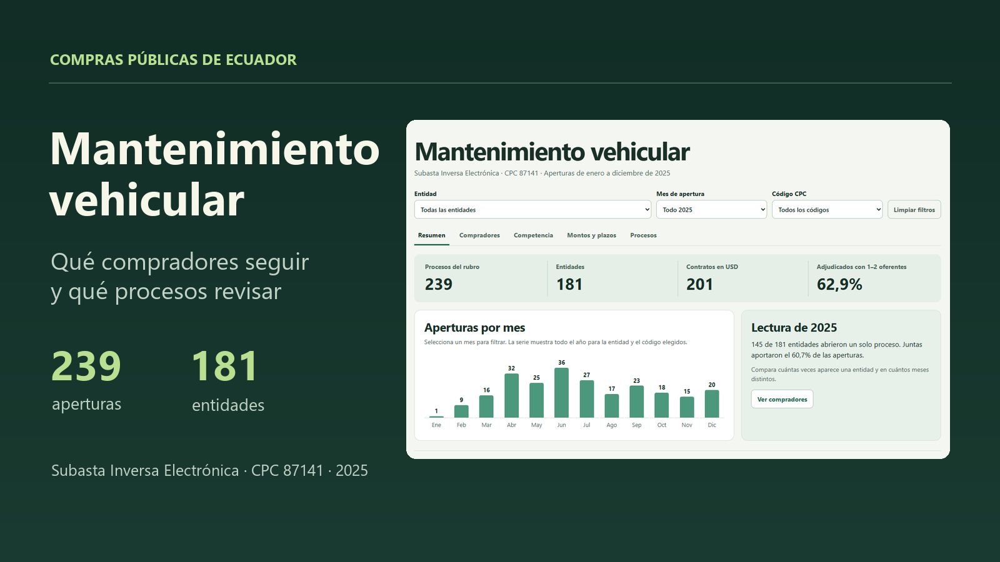

# Compras públicas de Ecuador · Mantenimiento vehicular



Un piloto para ayudar a talleres y pymes a elegir qué entidades públicas seguir y qué procesos revisar. Reúne **239 aperturas de 181 entidades** de enero a diciembre de 2025, en la modalidad de Subasta Inversa Electrónica y el grupo CPC 87141.

[Tablero público](https://compras-publicas-ecuador-vehicular.anthonyxm15.chatgpt.site) · [Caso de estudio](docs/fase-5-caso-de-estudio.md) · [Video corto](dashboards/presentacion.mp4) · [Subtítulos](dashboards/presentacion-es.vtt) · [Power BI Desktop (.pbix)](dashboards/powerbi/Mantenimiento%20vehicular.pbix)

## Explorar el piloto

- **Tablero.** Filtra por comprador, mes o código CPC. En **Procesos** puedes abrir cada ficha oficial de SERCOP. La [copia estática](dashboards/sitio/) se puede abrir localmente con `dashboards/sitio/index.html`.
- **Power BI Desktop.** Abre el archivo PBIX con sus datos de 2025 ya importados. El [proyecto editable](dashboards/powerbi/Mantenimiento%20vehicular.pbip), las [capturas](dashboards/capturas/) y el [recorrido narrado](dashboards/recorrido.mp4) muestran las cinco páginas. [Guía de los tableros](docs/fase-4-tableros.md).
- **Análisis.** El [cuaderno ejecutado](notebooks/fase-3-analisis.ipynb) conserva las tablas y los gráficos del corte del 22 de noviembre de 2026. La [nota de hallazgos](docs/fase-3-hallazgos.md) detalla las métricas.
- **Ciencia de datos.** La [validación temporal de montos](docs/fase-6-modelo-montos.md) compara el rango histórico general con uno por CPC e incluye el comando para reproducir la prueba.

## Reproducir con SERCOP y PostgreSQL

1. Desde la raíz del repositorio, prepara un entorno con Python 3.12. Instala las dependencias fijadas y ejecuta las pruebas.

   ```powershell
   python -m venv .venv
   .\.venv\Scripts\Activate.ps1
   python -m pip install -r requirements-analisis.txt
   python -m unittest discover -s tests
   ```

   Para ejecutar solo la carga y las exportaciones, instala `requirements.txt`. En macOS y Linux, activa el entorno con `source .venv/bin/activate`.

2. Crea una base PostgreSQL dedicada al piloto y usa un rol con permiso para crear esquemas en ella. El proyecto se verificó con PostgreSQL 18.7. Configura la conexión de acuerdo con tu instalación y guarda la contraseña en el archivo de libpq fuera del repositorio. Ejemplo en PowerShell. [Variables de libpq](https://www.postgresql.org/docs/18/libpq-envars.html).

   ```powershell
   $env:PGHOST = '127.0.0.1'
   $env:PGPORT = '5432'
   $env:PGDATABASE = 'compras_publicas'
   $env:PGUSER = 'compras_pipeline'
   $env:PGPASSFILE = 'C:\ruta\fuera-del-proyecto\pgpass.conf'
   python -m scripts.cargar_postgres
   ```

   El comando descarga los 12 cortes JSON de 2025, registra sus hashes, concilia los totales mensuales y carga los esquemas `limpio` y `analitico`. Al repetirlo, la carga reemplaza el año en una transacción. SERCOP puede corregir los cortes históricos y los resultados de una descarga nueva pueden variar. [Proceso de carga y diccionario](docs/fase-2-datos.md).

3. Desde el mismo entorno genera el extracto web y el proyecto Power BI. Para volver a ejecutar el análisis, abre el cuaderno en un editor compatible con Jupyter y selecciona el mismo entorno Python.

   ```powershell
   python -m scripts.exportar_tableros --salida dashboards/sitio
   python -m scripts.construir_powerbi
   ```

   Abre `dashboards/sitio/index.html` para revisar la web local. En Power BI Desktop puedes abrir el PBIP y guardar una copia como PBIX. Para refrescar desde PostgreSQL, usa los parámetros del informe y autentícate en el conector. [Configuración de Power BI](docs/fase-4-tableros.md#power-bi-desktop).

### Repetir el corte del caso

El [manifiesto original](docs/corte-2025.json) identifica los 12 ZIP mediante SHA-256. Si dispones de los archivos con esos hashes, colócalos en `data/raw/AAAA-MM/<sha256>.zip` y ejecuta `python -m scripts.cargar_postgres --desde-crudo docs/corte-2025.json` antes de exportar o abrir el cuaderno. El repositorio incluye los resultados ejecutados y el extracto estático. Los ZIP originales se conservan localmente.

## Estructura

| Ruta | Contenido |
| --- | --- |
| [`docs/`](docs/) | Caso de estudio, documentación de las fases y manifiesto |
| [`scripts/`](scripts/), [`sql/`](sql/), [`tests/`](tests/) | Descarga, transformación, modelo PostgreSQL y pruebas |
| [`notebooks/`](notebooks/) | Análisis ejecutado y gráfico del calendario |
| [`dashboards/`](dashboards/) | Copia estática, informe Power BI, videos y capturas |
| [`demo/`](demo/) | Prototipo inicial de aperturas y cobertura |

La publicación en Sites se gestiona desde el repositorio independiente de `dashboards/web`. La carpeta `dashboards/sitio` contiene la versión estática que se distribuye aquí. Los archivos crudos, las credenciales y la configuración y cachés locales de Power BI están excluidos de Git.

## Fuente y licencia

Datos de **SERCOP · Contrataciones Abiertas Ecuador**, bajo **CC BY 3.0 Ecuador**. El proyecto filtró por modalidad, fecha y CPC, normalizó los registros, relacionó las etapas de contratación y generó extractos y gráficos. El código y la documentación originales se distribuyen bajo la licencia MIT. [Fuente](https://datosabiertos.compraspublicas.gob.ec/PLATAFORMA/datos-abiertos/) · [Política de publicación](https://datosabiertos.compraspublicas.gob.ec/PLATAFORMA/documentos/politica-publicacion-SERCOP-OCDS.pdf) · [CC BY 3.0 Ecuador](https://creativecommons.org/licenses/by/3.0/ec/) · [Licencia MIT](LICENSE).
