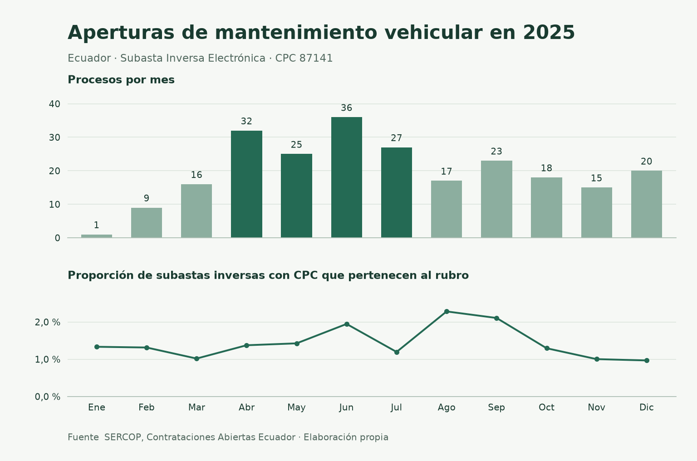

# Fase 3. Hallazgos del piloto de mantenimiento vehicular

Ecuador · Subasta Inversa Electrónica · CPC 87141 · Aperturas de 2025. La carga analizada del 22 de noviembre de 2026 contiene **239 procesos de 181 entidades**. El análisis de plazos incluye las firmas posteriores a 2025 cuando proceden de una apertura del año. [Fuente de SERCOP](https://datosabiertos.compraspublicas.gob.ec/PLATAFORMA/datos-abiertos/) · [Cuaderno ejecutado](../notebooks/fase-3-analisis.ipynb)

## Hallazgos priorizados

1. **Ordena los compradores por meses activos.** Solo 32 de las 181 entidades abrieron procesos en dos o más meses. Juntas reunieron 86 de los 239 procesos (36,0 %). El Distrito Metropolitano de Quito registró 5 aperturas en 5 meses y el Municipio de Zamora registró 4 en 4 meses. Sucumbíos y Milagro también tuvieron 5 procesos cada uno, repartidos en 3 meses. Para una lista de seguimiento, los meses activos ayudan a distinguir actividad repartida de varias aperturas juntas.
2. **Mantén una búsqueda por rubro junto a la lista de compradores.** Las 145 entidades con una sola apertura aportaron el **60,7 %** de los procesos identificados. Si el seguimiento se limita a compradores con actividad en varios meses, cubre 86 de los 239 procesos de 2025. Una búsqueda amplia por CPC complementa esa lista.
3. **Refuerza la revisión en los meses de mayor volumen observado.** De abril a julio hubo **120 aperturas**, el 50,2 % del año, y junio tuvo el máximo de 36. Al comparar con las subastas inversas con CPC de cada mes, agosto tuvo la mayor proporción del rubro (2,3 %), con 17 procesos. El volumen orienta cuánto trabajo de revisión hubo en 2025. Harían falta más años con cobertura comparable para programar esfuerzos por estacionalidad.
4. **Usa el conteo de oferentes al seleccionar fichas para revisar.** En **139 de 221 procesos adjudicados** (62,9 %) figuraron uno o dos oferentes. En 58 figuró uno solo. El número publicado coincide con los IDs distintos de oferentes en los 239 registros crudos del piloto. Esta medida describe la participación observada. La decisión de ofertar requiere revisar alcance, habilitación y capacidad para cada caso. [Definición OCDS de oferentes](https://standard.open-contracting.org/latest/en/schema/reference/)
5. **Reserva capacidad considerando varias semanas hasta la firma.** Entre los 201 procesos con firma registrada, la mediana desde la apertura fue de **42 días calendario** y la mitad central estuvo entre 33 y 56 días. En 35 casos (17,4 %) se superaron 60 días y 20 primeras firmas ocurrieron en 2026. Estos plazos se pueden usar para plantear escenarios de capacidad. Para estimar caja hacen falta fechas de ejecución y pagos.
6. **Usa los montos contractuales para dimensionar el alcance que vale la pena revisar.** En 201 contratos con monto positivo en USD, la mediana fue de **USD 28.446,39** y la mitad central quedó entre USD 15.699 y USD 54.200. Incluso para el código `871410011`, 99 contratos tuvieron un rango central de aproximadamente USD 18.503 a USD 53.700. Para preparar un precio, compara cantidades, tipos de flota, repuestos y duración en los pliegos.
7. **Revisa el objeto de los contratos con montos extremos.** La regla de 1,5 veces el rango intercuartílico señaló 24 contratos por encima de USD 111.951,50. El mayor, **USD 381.381,93**, incluye mantenimiento correctivo, repuestos y accesorios para vehículos, maquinaria y equipos del Municipio de La Troncal. Es una señal para revisar el alcance antes de usar la ficha como comparable. [Ficha oficial de La Troncal](https://datosabiertos.compraspublicas.gob.ec/PLATAFORMA/ocds/ocds-5wno2w-SIE-GADMLT-2025-025-2670)

## Límites que afectan el uso

En la modalidad hubo **1.014 de 18.333 procesos sin CPC** (5,5 %), con rubro sin identificar. Al corte, 38 procesos del piloto carecían de una firma utilizable y un contrato carecía de proveedor enlazado por adjudicación. Los 239 registros crudos del piloto omiten `tenderPeriod.endDate`. Una alerta de cierre requiere verificar el cronograma de la ficha oficial antes de usarla. [Documentación de SERCOP](https://datosabiertos.compraspublicas.gob.ec/PLATAFORMA/notas-metodologicas)

## Validación comercial

**Prototipo de entregable.** Un reporte mensual del rubro con compradores ordenados por meses activos, aperturas recientes, enlaces a fichas y referencias de tamaño de contrato. El material de 2025 sirve como muestra para la entrevista. La versión mensual requiere un corte vigente. El buscador, el historial y las alertas ya están disponibles en servicios del mercado. La prueba debe medir si una selección por recurrencia y alcance cambia una decisión del taller. [Planes de Licita.ec](https://licita.ec/precios)

**Prueba con 5 a 10 proveedores.** En dos casos comparables, pide que cada persona elija tres entidades para seguir y decida si revisaría dos fichas según el tipo de flota que atiende. Usa el portal habitual en un caso y el prototipo en el otro. Alterna el orden. Registra tiempo, aciertos al localizar fichas, decisiones que cambiaron y el campo que motivó cada cambio. Estima el ahorro con la mediana de las diferencias de tiempo entre tareas comparables.

**Hipótesis de precio.** Probar **USD 15 por un mes** de un reporte con datos vigentes. Registra si la persona aceptaría participar en la prueba a ese precio y qué pediría antes de comprometerse. El precio es una decisión de diseño del experimento. Las entrevistas y la medición del ahorro siguen pendientes.

## Reproducir los resultados

El [cuaderno](../notebooks/fase-3-analisis.ipynb) conserva los resultados ya ejecutados. Para repetirlos, usa un kernel Python 3.12 con `requirements-analisis.txt`, la [base de la Fase 2](fase-2-datos.md) y los ZIP originales del manifiesto analizado. En este equipo, el entorno Python del proyecto ya contiene las dependencias. Para recuperar el mismo corte desde otra carga, usa el manifiesto de la primera carga indicado en la Fase 2.
