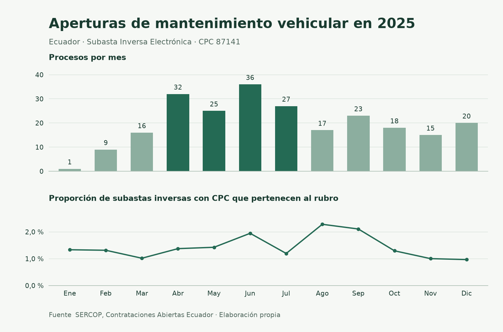

# Cómo priorizar compradores públicos de mantenimiento vehicular en Ecuador

## Resumen ejecutivo

Una pyme de mantenimiento vehicular necesita decidir qué compradores públicos seguir y qué procesos vale la pena revisar. 
El proyecto reunió datos de SERCOP en un tablero con filtros por comprador, mes y rubro. 
En 2025 se identificaron **239 aperturas de 181 entidades** en la modalidad de Subasta Inversa Electrónica. 
**145 entidades abrieron un solo proceso**, que en conjunto representaron el 60,7 % de las aperturas identificadas. 
El historial permite armar una lista corta de compradores recurrentes y complementarla con una búsqueda amplia por rubro. El ahorro de tiempo aún está por medir.

[Abrir el tablero](https://compras-publicas-ecuador-vehicular.anthonyxm15.chatgpt.site) · [Ver la presentación](../dashboards/presentacion.mp4) · [Consultar el cuaderno ejecutado](../notebooks/fase-3-analisis.ipynb)

## Problema

Para un taller, revisar cada ficha requiere tiempo. Antes de invertirlo, conviene saber qué entidades compran servicios que puede atender, cuándo abrieron procesos y qué tamaño tuvieron sus contratos. El portal de SERCOP permite consultar las fichas. El piloto reúne el historial del rubro para que el taller pueda elegir por dónde empezar y llegar desde el tablero a cada ficha oficial.

## Datos y metodología

Se usaron los doce cortes mensuales de SERCOP por su cobertura nacional y porque un mismo identificador permite seguir cada proceso desde la convocatoria hasta sus adjudicaciones y contratos. Se conciliaron **18.333 procesos** de la modalidad con los conteos del portal. El piloto retuvo los procesos cuyo período de presentación de ofertas empezó en 2025 y tenían al menos un ítem con un código del grupo **CPC 87141**, mantenimiento vehicular. Se contó cada proceso una vez y se agrupó a los compradores por su identificador. El corte quedó registrado el 22 de noviembre de 2026. [Fuente de SERCOP](https://datosabiertos.compraspublicas.gob.ec/PLATAFORMA/datos-abiertos/) · [Clasificador del INEC](https://aplicaciones2.ecuadorencifras.gob.ec/SIN/resul_correspondencia.php?ciiu=9&id=87141) · [Manifiesto del corte](corte-2025.json).

Una **apertura** marca el inicio del período para presentar ofertas. Una **adjudicación** registra la selección de un proveedor y puede haber más de una por proceso. Un **contrato** aporta sus propios datos de monto y firma. Python descargó y comprobó los archivos, PostgreSQL organizó cada etapa y el cuaderno calculó los indicadores que se presentan en Power BI y en la web. [Metodología y diccionario](fase-2-datos.md) · [Guía de los tableros](fase-4-tableros.md).

## Hallazgos

| Qué se observó | Qué decisión orienta |
| --- | --- |
| **32 de 181 entidades** abrieron procesos en al menos dos meses. Reunieron **86 de 239 aperturas**. Las 145 entidades con una sola apertura reunieron otras 145. | Ordenar una lista corta por meses activos y mantener la búsqueda general por rubro para detectar compradores ocasionales. |
| **120 de 239 aperturas** ocurrieron entre abril y julio. Junio tuvo el máximo, con **36**. | Estimar cuánto trabajo de revisión habría requerido cada mes de 2025. |
| **139 de 221 procesos adjudicados con conteo** registraron uno o dos oferentes (**62,9 %**). En este corte, los 221 procesos con adjudicación tienen conteo. | Elegir fichas para investigar qué se pidió y quién podía participar. La participación observada por sí sola no permite estimar la probabilidad de ganar. |
| La primera firma observada tardó una mediana de **42 días calendario** desde la apertura en los **201 procesos con firma utilizable**. La mitad central tardó entre **33 y 56 días**. | Preparar escenarios de capacidad que contemplen varias semanas entre la apertura y la firma. |
| Los **201 contratos con monto positivo en USD** tuvieron una mediana de **USD 28.446,39**. La mitad central quedó entre **USD 15.699 y USD 54.200**. | Dimensionar qué fichas vale la pena comparar. El monto corresponde al contrato completo y depende de la flota, los repuestos y la duración. |

El conteo de 201 procesos para el plazo incluye la primera firma utilizable por proceso, incluso si ocurrió en 2026. El conteo de 201 contratos para montos aplica el filtro de moneda y valor a cada contrato. [Cálculos, cobertura y ejemplos](fase-3-hallazgos.md).

## Cómo se usaría

Al preparar su lista mensual de seguimiento, la persona encargada de cotizar en un taller puede ordenar a los compradores por meses activos. Por ejemplo, **Quito registró cinco aperturas en cinco meses** y **Zamora, cuatro en cuatro meses**. Luego puede explorar todo el rubro para ampliar la lista, filtrar por el código más cercano a su servicio y abrir las fichas que encajen con su capacidad. El calendario y los requisitos vigentes se comprueban en el portal oficial. [Tablero público](https://compras-publicas-ecuador-vehicular.anthonyxm15.chatgpt.site) · [Buscador de SERCOP](https://datosabiertos.compraspublicas.gob.ec/PLATAFORMA/procedimientos).

## Impacto estimado

En un **escenario ilustrativo**, una pyme hace **cuatro revisiones al mes**. Si cada revisión pasa de **30 a 15 minutos** gracias a los filtros y enlaces, liberaría **una hora al mes**. Con un costo interno supuesto de **USD 10 por hora**, ese tiempo equivaldría a **USD 10 mensuales**. La frecuencia, los tiempos y el costo son supuestos. El estudio aún no cuenta con mediciones de ahorro, cambios en adjudicaciones ni disposición a pagar.

Para medirlo, se propone que entre cinco y diez proveedores elijan compradores y encuentren fichas para dos tareas comparables. Cada persona usa el portal habitual en una tarea y el prototipo en la otra. Se alterna el orden y se registra el tiempo, las fichas correctas y las decisiones que cambian. [Protocolo de validación](fase-3-hallazgos.md#validación-comercial).

## Limitaciones y próximos pasos

- **Cobertura.** En la modalidad, 1.014 de 18.333 procesos (5,5 %) carecían de CPC. El filtro puede dejar fuera procesos del rubro. El piloto describe una modalidad y un año de aperturas. Para evaluar estacionalidad hacen falta más años con cobertura comparable.
- **Plazos.** En 38 procesos del piloto faltaba una firma utilizable. La mediana describe los casos con firma observada. La fecha de cierre de ofertas faltaba en el corte, por lo que debe consultarse el cronograma de cada ficha. Las fechas de ejecución y de pago quedan fuera del análisis.
- **Validación.** El tablero público abre sin sesión y el refresco desde PostgreSQL se comprobó en Power BI Desktop. Queda pendiente una lectura con una persona ajena al proyecto. La prueba consiste en pedirle que explique a quién ayuda el tablero y qué haría con él después de ver el resumen. [Verificación de los tableros](fase-4-tableros.md).

## Prueba de estimación de montos

Con el historial disponible al inicio de cada mes, se estimó un rango de monto para los contratos de las aperturas de julio a diciembre de 2025. El rango general cubrió **43 de 99 montos observados**. Al usar rangos más estrechos por código CPC donde había suficientes comparables, la cobertura bajó a **36 de 99** y el error medio de la estimación quedó cerca de **USD 40.000** en ambos modelos. El tablero presenta montos históricos para seleccionar fichas comparables. [Validación temporal y resultados](fase-6-modelo-montos.md).

_SERCOP · Contrataciones Abiertas Ecuador. Elaboración propia a partir de registros filtrados, normalizados y agregados._ [Datos de origen](https://datosabiertos.compraspublicas.gob.ec/PLATAFORMA/datos-abiertos/) · [CC BY 3.0 Ecuador](https://creativecommons.org/licenses/by/3.0/ec/).
